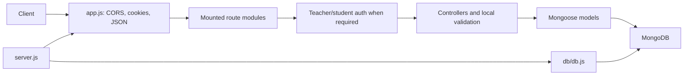

# Backend Architecture

## Overview

The backend is a CommonJS Node.js application using Express 5, Mongoose, and
MongoDB. It provides authentication, public course/subject catalog reads, and
teacher profile and chapter operations. Route handlers call controllers
directly; the repository has no separate service layer or centralized
validation layer.

## Startup and request lifecycle

1. `backend/server.js` loads `.env` with `dotenv`, imports the Express app and
   calls the database connection helper.
2. The server starts listening on port `3000`.
3. `backend/app.js` installs CORS, cookie parsing, and JSON body parsing, then
   mounts routers.
4. A route optionally executes authentication middleware before invoking its
   controller.
5. Controllers validate request data, query or update Mongoose models, and
   construct the JSON response.
6. Mongoose communicates with MongoDB using `MONGODB_URI`.

## Startup behavior

The database helper logs successful connection or connection errors. It does
not return or await the `mongoose.connect()` promise, and `server.js` starts
listening without waiting for a confirmed database connection. Therefore,
`http://localhost:3000` being reachable does not itself prove MongoDB is
connected. See [Troubleshooting](./troubleshooting.md#database-connection-failures).

## Route mounts

`backend/app.js` mounts:

| Mount path | Router | Responsibility |
|---|---|---|
| `/auth` | `routes/auth.routes.js` | Student and teacher registration, login, logout |
| `/courses` | `routes/course.routes.js` | Course and subject catalog reads |
| `/subjects` | `routes/course.routes.js` | A second mount of the same course/subject router |
| `/teachers` | `routes/teacher.routes.js` | Current teacher profile operations |
| `/teachers/chapters` | `routes/chapter.routes.js` | Teacher-owned chapter operations |

Because the same catalog router is mounted at both `/courses` and `/subjects`,
the canonical route for a subject lookup is
`GET /courses/subjects/:subjectId`; its second mount also exposes
`GET /subjects/subjects/:subjectId`. The latter is a consequence of the mount,
not a separately authored route.

## Module responsibilities

- `backend/controller/`: HTTP-level input validation and endpoint behavior.
- `backend/routes/`: Express method/path registrations and middleware wiring.
- `backend/middleware/auth.middleware.js`: cookie JWT verification, role
  checks, and loading the current Student or Teacher.
- `backend/model/`: Mongoose schemas and MongoDB model declarations.
- `backend/db/db.js`: starts the MongoDB connection.
- `backend/seed/seedCourses.js`: upserts two courses and their three subjects
  for each configured class level.

For a searchable file-by-file guide, see [Modules](./modules.md).

## Database and external services

MongoDB is the only external service referenced in the backend runtime code.
Mongoose model references connect students, teachers, courses, subjects,
chapters, classes, and course enrollments. The model relationships and
constraints are detailed in [Database](./database.md).

## Request context

The Express app installs `cookieParser()` before protected routers, so
authentication middleware reads `req.cookies.token`. JSON routes use
`express.json()`. Controllers take route parameters from `req.params` and JSON
payloads from `req.body`; authenticated teacher/student data is set on
`req.teacher` or `req.student`.
